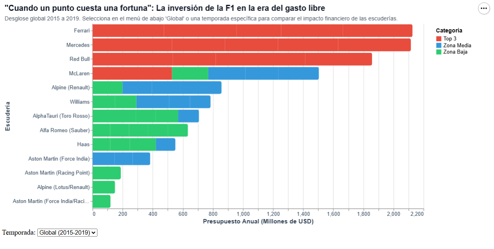

# Cuando un punto cuesta una fortuna: la época dorada del derroche en la Fórmula 1

*Por Sergio Herrera*

Hubo un tiempo en la máxima categoría del automovilismo mundial en el que ganar no solo dependía del talento de los pilotos o del equipo... El ganador se definia por el "ancho de su billetera". Entre 2015 y 2019, en la Fórmula 1 transitó por su último gran periodo la libertad financiera absoluta, una era histórica conocida como ladel gasto libre, justo antes de que la irrupción global de la pandemia y la posterior llegada del límite presupuestario transformaran para siempre las reglas de la pista.

Al hacer memoria y analizar los datos de aquellos años, se expone una asimetría estructural abismal: gigantes corporativos como Mercedes, Ferrari y Red Bull operaron con inversiones ilimitadas, inyectando cifras multimillonarios de 400 y 500 millones de dólares anuales por escudería. Mientras que los equipos recien llegados o de catgorias inferior luchaban por la supervivencia con apenas un tercio de esos recursos.

A copntinuación se puede revisar el comportamiento temporada a temporada (2015-2019). Revisando cómo La inversión récord de los líderes en las carreras traían consigo los puntos. Donde vemos que hubo escuderías que llegaron a gastar *más de un millón de dólares* por cada punto solitario sumado en el campeonato, desnmostrando que el dinero masivo no siempre les garantizaba el punto de una forma optima en cuanto a sus inversiones.

Este modelo de competencia desregulada se convirtió en una bomba de tiempo. La brecha entre los tres grandes y el resto de la parrilla hizo insostenible la participación de los demás equipos, obligando a la categoría a poner fin a esta era con la nueva reglamentación de limite presupuestario por año.
